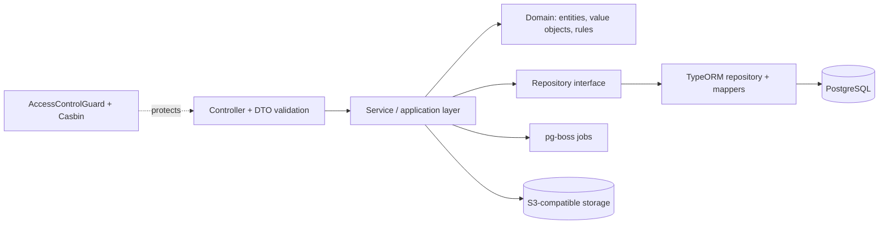

# 🚀 Rocket Store

Headless e-commerce backend built with **NestJS, PostgreSQL and TypeORM**.
Designed as a **single-tenant product: one independent deployment per customer**, so every store has fully isolated data and its own configuration.

> **Status: under active development.** The first stable backend release is in progress. See [Project status](#project-status) for what works today.


## Highlights

- **Modular architecture**: every business module is split into `domain` / `dto` / `infrastructure`, with repository interfaces and TypeORM implementations behind them.
- **Fine-grained authorization**: Better-auth for authentication, Casbin for RBAC, a custom guard and a `@RequirePermission()` decorator. Anti privilege-escalation rule: a user can only grant permissions that are a subset of their own.
- **Errors as values**: domain operations return `Result` types (`@allawiii/results-ts`). A central error-mapper registry and one exception filter translate domain errors into HTTP responses.
- **Background jobs on Postgres** with `pg-boss`, so there is no extra queue infrastructure to run per customer.
- **S3-compatible object storage** (RustFS) with presigned URLs for product and store images.
- **Serious test setup**: unit specs next to the code, plus e2e suites on top of reusable fixtures, builders and helpers (see [Testing](#testing)).
- **Strict tooling**: TypeScript, Biome (lint + format), Vitest with SWC, pnpm.

## Architecture



```
src/
├── app-config/ app-logger/ database/ email/ jobs/ error/ object-storage/   # cross-cutting infrastructure
└── modules/
    ├── users/ access-control/ brands/ categories/ images/ ...
    │   ├── domain/            # pure business types and rules
    │   ├── dto/               # request/response contracts
    │   └── infrastructure/    # entities, mappers, repositories
    └── shared/                # value objects, decorators, validation, utils
```

## Key design decisions

| Decision | Why | Trade-off |
|---|---|---|
| One deployment per customer (single-tenant) | Full data isolation, per-customer customization, one customer's load or failure never affects another | More instances to upgrade, so deploys and migrations must be automated and repeatable |
| Repository interface + TypeORM implementation + mapper | Services and domain do not depend on the ORM; easy to unit test with fakes | More files per module |
| Value objects (`Email`, `Phone`, `Sha256Checksum`, `ImageMimeType`, …) | Invalid data is rejected at the domain boundary instead of deep inside the app | Some boilerplate |
| `Result` types instead of throwing for expected failures | Failure paths are explicit in the type signature | Needs discipline at the edges (handled by the error-mapper registry) |
| Casbin with a permission-dependency table | Permissions and roles are data, not hard-coded checks, and escalation rules live in one place | Policy sync must be kept consistent (`access-control-sync.service`) |
| `pg-boss` for jobs | Reuses PostgreSQL, so one less service per customer deployment | Not the right tool for very high-throughput queues |
| Roles stored with a GIN index on permissions | Fast permission-containment queries | Extra index maintenance on writes |

## Project status

| Area | State |
|---|---|
| Auth, sessions, email flows | ✅ Implemented |
| Users and addresses | ✅ Implemented |
| Roles and permissions (access control) | ✅ Implemented |
| Brands, categories | ✅ Implemented |
| Images + storage + cleanup worker | ✅ Implemented |
| Products and variants, carts, orders | 🚧 Data model done, API in progress |
| Payments, shipping, promotions | 🚧 Data model done, API in progress |
| Reviews, wishlist, audit log | 🚧 Data model done, API in progress |
| Storefront (NextJS) + GrapesJS page builder | 🗓 Planned |

<!-- TODO: adjust this table so it matches reality exactly. Only claim what actually works. -->

## Getting started

you need to start `RustFS`, `PostgreSQL` and `MailHog` (for testing) docker instances.

take a look at all used [environment variables](test/support/constants/env-test-values.constant.ts) (you must offer them in `.env` file or inject them in process)

```bash
pnpm install
pnpm start:dev
```

<!-- TODO: add docker-compose instructions for Postgres, Redis (if used), RustFS and MailHog. -->

## Testing

```bash
pnpm test          # unit tests (watch)
pnpm test:run      # unit tests (single run)
pnpm test:e2e      # end-to-end suites
pnpm test:cov      # coverage
pnpm lint:ci       # Biome in CI mode
```

Test support code lives in `test/support/`:

- `fixtures/`: authenticated e2e fixture (ready-made logged-in user)
- `builders/helpers`: user-flow builder, app/database/storage/mail helpers
- `doubles/`: MailHog email service and config mocks
- `utils/`: random data generators, `wait-job-until-finish`, response parsers

Goal: a new e2e test should be a few lines, with no setup boilerplate.

## Tech stack

NestJS · TypeScript · PostgreSQL · TypeORM · Better-auth · Casbin · pg-boss · AWS S3 SDK (RustFS) · Zod / class-validator · Pino · Vitest · Biome · pnpm · Docker

## License

UNLICENSED, private project.
